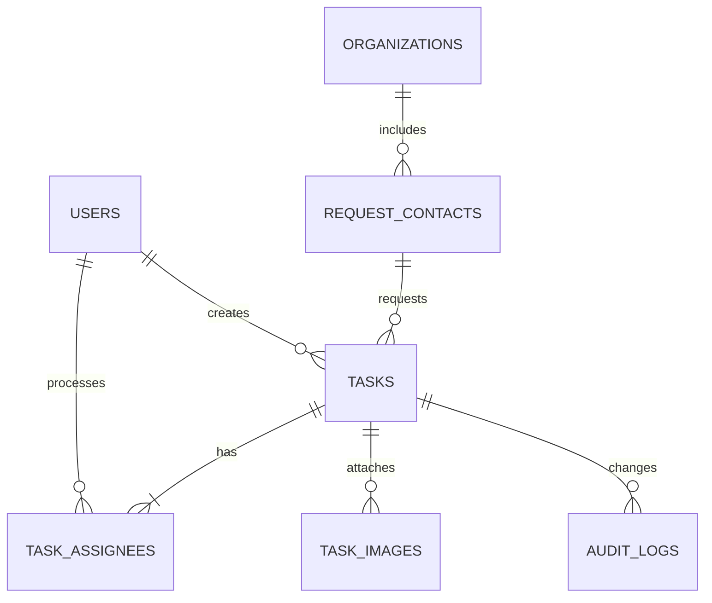

# 공유 업무 캘린더 PRD (MVP)

> 기존 제품·데이터·권한 계약은 이 문서를 유지한다. 2026-10-03 승인된 신규 고도화와 AI Pro 연속 개발의 활성 범위는 [고도화 PRD](docs/UPGRADE_PRD_20261003.md)다. 과거 진행 기록의 “추가 Phase 없음”은 이 신규 승인 이후의 중단 조건이 아니다.

| 항목 | 내용 |
|---|---|
| 제품명 | 공유 업무 캘린더 |
| 문서 목적 | 개발 에이전트(Codex)가 바로 구현을 시작할 수 있도록 MVP 범위, 권한, 화면, 데이터 및 검수 기준을 정의한다. |
| 사용자 역할 | 관리자(Admin), 일반 이용자(Member) |
| 기준 버전 | v1.0 |

## 1. 제품 개요

여러 이용자가 업무를 접수하고 처리 상태를 관리하는 내부 업무 캘린더다. 업무는 여러 명에게 동시에 배정할 수 있고, 일반 이용자는 자신이 등록했거나 처리자로 지정된 업무만 확인한다. 관리자는 모든 업무와 사용자 정보를 관리한다.

캘린더에는 업무의 **접수일**을 기본 기준으로 표시한다. 처리 완료된 업무는 **처리일**도 함께 기록하여 이력과 월별 처리 현황을 확인할 수 있다.

## 2. 목표와 범위

### 2.1 MVP 목표

1. 관리자가 일반 이용자 계정을 만들고 활성/비활성 관리할 수 있다.
2. 일반 이용자가 업무를 등록하고, 한 건에 여러 처리자를 지정할 수 있다.
3. 일반 이용자는 자신의 업무만 한눈에 보고 상태를 갱신할 수 있다.
4. 요청 담당자·연락처·소속 기관을 재사용 가능한 마스터 데이터로 관리한다.
5. 관리자는 전체 업무를 조회, 수정, 상태 변경, 사용자 관리할 수 있다.

### 2.2 Phase 2 후속 범위

- 이메일·문자·메신저 알림
- 업무 마감일, 반복 업무, 외부 캘린더 연동
- 파일 외 첨부 형식(문서, 동영상 등)과 이미지 편집
- 사용자별 세분화된 권한(예: 팀장, 읽기 전용)
- 통계 대시보드, 엑셀 다운로드

위 항목은 MVP 안정화 후 **자동으로 Phase 2에서 구현**한다. 기능 구현과 관련 테스트·검증을 마친 뒤 다음 Phase 2 항목으로 끊김 없이 진행한다.

## 3. 용어 정의

| 용어 | 정의 |
|---|---|
| 업무 | 접수부터 처리 완료까지 관리하는 하나의 요청 건 |
| 처리자 | 실제 업무를 처리하는 일반 이용자. 한 업무에 복수 지정 가능 |
| 요청 담당자 | 업무를 요청하거나 지시한 외부/클라이언트 측 담당자 |
| 기관 | 요청 담당자의 소속 기관 또는 회사 |
| 내 업무 | 현재 로그인 사용자가 등록했거나 처리자로 지정된 업무 |
| 처리 | 업무가 완료된 상태. 최초 처리 전환 시 처리일을 자동 기록 |

> 원문 요구사항의 “담당자(시킨 사람)”는 혼동을 막기 위해 화면과 데이터 모델에서 **요청 담당자**로 표기한다. 처리자는 별도의 필드로 유지한다.

## 4. 역할과 권한

### 4.1 권한 매트릭스

| 기능 | 관리자 | 일반 이용자 |
|---|---:|---:|
| 로그인/로그아웃 | 가능 | 가능 |
| 내 업무 조회 | 가능 | 가능 |
| 전체 업무 조회 | 가능 | 불가 |
| 업무 등록 | 가능 | 가능 |
| 업무 상세 조회 | 전체 | 본인이 등록했거나 처리자로 지정된 업무만 |
| 업무 수정/상태 변경 | 전체 | 접근 가능한 업무만 |
| 업무 삭제 | 가능 | 불가 (MVP) |
| 사용자 등록/수정/비활성화 | 가능 | 불가 |
| 요청 담당자/기관 마스터 관리 | 가능 | 등록 시 자동 추가·선택 가능 |

### 4.2 일반 이용자 데이터 노출 정책

1. 일반 이용자 목록 화면에서는 다른 이용자의 업무를 볼 수 없다.
2. 업무 목록·캘린더 API는 서버에서 현재 사용자 기준으로 필터링한다. 화면에서만 숨기는 방식은 허용하지 않는다.
3. 공동 처리 업무는 해당 업무의 제목, 내용, 상태, 요청 정보, 같은 업무에 지정된 처리자만 볼 수 있다.
4. 관리자는 모든 업무를 조회하며, 사용자별 필터로 특정 이용자의 업무를 볼 수 있다.

## 5. 핵심 업무 흐름

### 5.1 업무 등록

1. 로그인 사용자가 `업무 등록`을 누른다.
2. 처리자 1명 이상을 선택한다. 복수 선택 가능하다.
3. 요청 담당자를 기존 목록에서 검색·선택하거나 새로 입력한다.
4. 새 요청 담당자 입력 시 연락처와 기관을 입력하며, 저장 시 마스터 데이터에도 등록한다.
5. 업무 내용과 이미지(선택)를 입력하고 등록한다.
6. 상태는 기본값 `접수`, 접수일은 등록일로 자동 설정한다. 관리자는 접수일을 수정할 수 있으며, 일반 이용자도 자신의 등록 업무에 한해 수정 가능하다.
7. 저장 후 처리자들의 내 업무 목록과 접수일 기준 캘린더에 노출된다.

### 5.2 상태 처리

| 이전 상태 | 변경 가능 상태 | 처리일 규칙 |
|---|---|---|
| 접수 | 진행중, 처리 | 처리로 변경하면 오늘 날짜 자동 입력 |
| 진행중 | 접수, 처리 | 처리로 변경하면 오늘 날짜 자동 입력 |
| 처리 | 접수, 진행중 | 처리일을 비움. 다시 처리 시 새 처리일 기록 |

처리일이 자동 입력된 뒤에는 관리자 또는 접근 권한이 있는 일반 이용자가 날짜를 수정할 수 있다. 상태가 `처리`가 아니면 처리일은 반드시 비어 있어야 한다.

### 5.3 요청 담당자 재사용

1. 업무 등록 화면에서 요청 담당자 이름 또는 기관명으로 자동완성 검색한다.
2. 기존 담당자를 선택하면 연락처와 기관을 자동 채운다.
3. 연락처 또는 기관이 변경되면 사용자는 해당 업무에 반영할 수 있고, 관리자만 마스터 원본을 수정한다.
4. 같은 이름의 담당자가 다른 기관에 있을 수 있으므로, 자동완성 항목은 `이름 · 기관 · 연락처`로 구분해 표시한다.

## 6. 상세 기능 요구사항

### FR-01. 인증

- 계정 ID와 비밀번호로 로그인한다.
- 계정은 관리자가 생성한다. 공개 회원가입은 제공하지 않는다.
- 최초 비밀번호는 관리자가 발급하며, 첫 로그인 후 변경을 요구한다.
- 비활성 계정은 로그인할 수 없다.
- 로그아웃 시 세션 또는 토큰을 무효화한다.

### FR-02. 사용자 관리 (관리자 전용)

- 사용자 목록에서 이름, 로그인 ID, 역할, 활성 상태, 생성일을 조회한다.
- 일반 이용자를 등록한다. 필수 값: 이름, 로그인 ID, 임시 비밀번호.
- 로그인 ID는 중복될 수 없다.
- 사용자 이름·역할·활성 상태를 수정한다.
- 이미 업무 이력이 있는 사용자는 물리 삭제하지 않고 비활성 처리한다.
- 관리자는 일반 이용자를 관리자로 승격하거나 반대로 변경할 수 있다. 마지막 활성 관리자 계정은 일반 이용자로 변경하거나 비활성화할 수 없다.

### FR-03. 업무 등록

필수 입력 항목은 처리자, 요청 담당자, 요청 담당자 연락처, 요청 담당자 소속 기관, 업무 내용이다.

| 필드 | 입력 방식 | 규칙 |
|---|---|---|
| 처리자 | 다중 선택 | 활성 일반 이용자 1명 이상. 관리자도 필요 시 처리자로 지정 가능 |
| 상태 | 선택 | 접수/진행중/처리, 기본값 접수 |
| 요청 담당자 | 자동완성 또는 신규 입력 | 최대 50자 |
| 요청 담당자 연락처 | 자동 채움 또는 입력 | 전화번호 형식 검증, 최대 30자 |
| 요청 담당자 소속 기관 | 자동완성 또는 신규 입력 | 최대 100자 |
| 업무 설명 | 여러 줄 텍스트 | 필수, 최대 5,000자 |
| 이미지 | 다중 첨부 | 선택, JPG/PNG/WEBP만, 최대 5개·파일당 10MB |
| 접수일 | 날짜 | 기본값 오늘, 필수 |
| 처리일 | 날짜 | 상태가 처리일 때만 입력 가능 |

등록자는 자동으로 업무 생성자로 저장한다. 상태를 `처리`로 처음 등록하면 처리일은 기본값으로 오늘 날짜를 넣는다.

### FR-04. 업무 목록 및 내 업무 대시보드

- 일반 이용자 첫 화면은 `내 업무`다.
- 상단 요약 카드: 접수 건수, 진행중 건수, 처리 건수.
- 목록 기본 정렬: 상태 우선(접수 → 진행중 → 처리), 같은 상태에서는 접수일 내림차순.
- 목록 항목: 상태, 업무 내용 첫 줄, 요청 담당자, 기관, 처리자, 접수일, 처리일.
- 필터: 상태, 접수일 기간, 처리자(관리자만), 요청 담당자/기관 키워드.
- 검색: 업무 내용, 요청 담당자, 기관을 대상으로 부분 일치 검색.
- 일반 이용자의 처리자 필터는 자기 자신으로 고정하며 변경할 수 없다.

### FR-05. 캘린더

- 월간 캘린더를 기본 화면으로 제공하고 이전/다음 달로 이동할 수 있다.
- 각 날짜에는 해당 접수일의 업무를 상태 색상으로 표시한다.
  - 접수: 회색
  - 진행중: 파랑
  - 처리: 초록
- 날짜 칸에는 업무 제목 대신 업무 내용의 앞 20자와 상태를 표시한다.
- 하루에 표시 가능한 수를 넘으면 `+N건`으로 요약하고 클릭 시 해당 날짜의 업무 목록을 연다.
- 캘린더의 업무를 선택하면 상세 화면 또는 상세 패널을 연다.
- 처리일이 있는 업무는 상세 화면에서 처리일을 표시한다. MVP에서는 처리일 기준 별도 캘린더 뷰를 제공하지 않는다.
- 관리자 캘린더는 전체 업무를, 일반 이용자 캘린더는 내 업무만 보여준다.

### FR-06. 업무 상세 및 수정

- 상세 화면에는 전체 업무 정보, 첨부 이미지 미리보기, 생성자, 생성·수정 시각을 표시한다.
- 접근 권한이 있는 일반 이용자와 관리자는 상태·처리자·요청 정보·내용·이미지를 수정할 수 있다.
- 업무 생성자는 처리자로 지정되지 않아도 본인이 만든 업무를 조회·수정할 수 있다.
- 수정 시 누가 언제 어떤 필드를 변경했는지 이력 로그를 남긴다.
- 관리자는 업무를 삭제할 수 있다. 삭제 전 확인 창을 띄우며, 실제 DB에서는 삭제 일시와 삭제자만 기록하는 소프트 삭제를 사용한다.

### FR-07. 요청 담당자·기관 마스터

- 기관: 기관명, 사용 여부, 생성/수정 시각을 관리한다.
- 요청 담당자: 이름, 연락처, 기관, 사용 여부, 생성/수정 시각을 관리한다.
- 업무 등록에서 신규 기관 또는 신규 담당자를 입력하면 중복 여부를 확인한 뒤 마스터에 생성한다.
- 동일한 `이름 + 연락처 + 기관` 조합은 중복 생성하지 않는다.
- 관리자 화면에서 기관과 요청 담당자를 검색, 수정, 사용 중지할 수 있다.
- 사용 중지된 마스터 데이터는 기존 업무에서는 유지해 보이지만 신규 업무 선택 목록에는 나타나지 않는다.

### FR-08. 감사 로그

- 다음 이벤트는 감사 로그로 남긴다: 로그인 성공/실패, 사용자 생성·수정·비활성화, 업무 생성·수정·삭제, 상태 변경, 처리자 변경, 마스터 데이터 변경.
- 로그 항목: 이벤트 종류, 대상 유형/ID, 변경 전 값, 변경 후 값, 실행자, 실행 시각, IP(가능한 경우).
- 일반 이용자는 감사 로그에 접근할 수 없다.

## 7. 화면 구성

| 화면 ID | 화면명 | 대상 | 핵심 요소 |
|---|---|---|---|
| SCR-01 | 로그인 | 전체 | 로그인 ID, 비밀번호, 로그인 버튼 |
| SCR-02 | 내 업무 대시보드 | 전체 | 상태별 건수, 필터, 검색, 업무 목록, 업무 등록 버튼 |
| SCR-03 | 월간 캘린더 | 전체 | 월 이동, 상태 범례, 날짜별 업무, 상세 열기 |
| SCR-04 | 업무 등록/수정 | 권한 사용자 | 처리자 다중 선택, 요청 정보 자동완성, 설명, 이미지, 상태·날짜 |
| SCR-05 | 업무 상세 | 권한 사용자 | 전체 업무 정보, 이미지, 수정/상태 변경, 변경 이력 |
| SCR-06 | 사용자 관리 | 관리자 | 사용자 목록, 등록/수정/활성 상태 관리 |
| SCR-07 | 요청 정보 관리 | 관리자 | 기관·요청 담당자 목록, 검색, 수정, 사용 중지 |
| SCR-08 | 감사 로그 | 관리자 | 이벤트 유형/기간/실행자 필터, 상세 변경 이력 |

### 7.1 권장 내비게이션

일반 이용자: `내 업무` · `캘린더` · `업무 등록` · `내 계정` · `로그아웃`

관리자: `내 업무` · `전체 업무` · `캘린더` · `업무 등록` · `사용자 관리` · `요청 정보 관리` · `감사 로그` · `내 계정` · `로그아웃`

## 8. 데이터 모델

### 8.1 ER 관계 요약



### 8.2 테이블 정의

#### users

| 컬럼 | 타입 예시 | 제약/설명 |
|---|---|---|
| id | UUID/BIGINT | PK |
| login_id | VARCHAR(50) | UNIQUE, NOT NULL |
| password_hash | VARCHAR(255) | NOT NULL, 평문 저장 금지 |
| name | VARCHAR(50) | NOT NULL |
| role | ENUM | `ADMIN`, `MEMBER` |
| is_active | BOOLEAN | 기본 true |
| must_change_password | BOOLEAN | 기본 true |
| created_at / updated_at | TIMESTAMP | NOT NULL |

#### organizations

| 컬럼 | 타입 예시 | 제약/설명 |
|---|---|---|
| id | UUID/BIGINT | PK |
| name | VARCHAR(100) | UNIQUE, NOT NULL |
| is_active | BOOLEAN | 기본 true |
| created_at / updated_at | TIMESTAMP | NOT NULL |

#### request_contacts

| 컬럼 | 타입 예시 | 제약/설명 |
|---|---|---|
| id | UUID/BIGINT | PK |
| name | VARCHAR(50) | NOT NULL |
| phone | VARCHAR(30) | NOT NULL |
| organization_id | FK | organizations.id, NOT NULL |
| is_active | BOOLEAN | 기본 true |
| created_at / updated_at | TIMESTAMP | NOT NULL |

UNIQUE(name, phone, organization_id)

#### tasks

| 컬럼 | 타입 예시 | 제약/설명 |
|---|---|---|
| id | UUID/BIGINT | PK |
| requester_contact_id | FK | request_contacts.id, NOT NULL |
| status | ENUM | `RECEIVED`, `IN_PROGRESS`, `COMPLETED` |
| description | TEXT | NOT NULL, 최대 5,000자 |
| received_date | DATE | NOT NULL |
| completed_date | DATE | NULL. status=COMPLETED일 때만 값 존재 |
| created_by | FK | users.id, NOT NULL |
| created_at / updated_at | TIMESTAMP | NOT NULL |
| deleted_at / deleted_by | TIMESTAMP/FK | 소프트 삭제용, NULL 허용 |

#### task_assignees

| 컬럼 | 타입 예시 | 제약/설명 |
|---|---|---|
| task_id | FK | tasks.id |
| user_id | FK | users.id |
| assigned_at | TIMESTAMP | NOT NULL |

PK(task_id, user_id). 업무당 최소 1명 처리자를 애플리케이션과 DB 제약으로 보장한다.

#### task_images

| 컬럼 | 타입 예시 | 제약/설명 |
|---|---|---|
| id | UUID/BIGINT | PK |
| task_id | FK | tasks.id, NOT NULL |
| storage_key | VARCHAR(255) | 비공개 객체 저장소 경로 |
| original_filename | VARCHAR(255) | NOT NULL |
| mime_type | VARCHAR(50) | 허용 이미지 형식만 |
| size_bytes | BIGINT | 파일당 10MB 이하 |
| sort_order | INTEGER | 미리보기 정렬 |
| uploaded_by | FK | users.id |
| created_at | TIMESTAMP | NOT NULL |

#### audit_logs

| 컬럼 | 타입 예시 | 제약/설명 |
|---|---|---|
| id | UUID/BIGINT | PK |
| actor_user_id | FK | users.id, NULL 가능 |
| action | VARCHAR(50) | 예: TASK_UPDATED |
| target_type / target_id | VARCHAR / UUID | 변경 대상 |
| before_data / after_data | JSON | 민감 정보는 마스킹 |
| ip_address | VARCHAR(45) | 선택 |
| created_at | TIMESTAMP | NOT NULL |

## 9. API 초안

모든 API는 로그인 인증이 필요하며, API 서버에서 역할과 업무 접근 권한을 검사한다. 날짜는 `YYYY-MM-DD`, 시간은 ISO 8601 UTC 형식을 사용한다.

| Method | Endpoint | 설명 | 권한 |
|---|---|---|---|
| POST | /api/auth/login | 로그인 | 전체 |
| POST | /api/auth/logout | 로그아웃 | 전체 |
| GET | /api/me | 내 계정/권한 조회 | 전체 |
| GET | /api/tasks | 업무 목록·검색·필터 | 권한 필터 적용 |
| POST | /api/tasks | 업무 등록 | 전체 |
| GET | /api/tasks/{id} | 업무 상세 | 관리자 또는 참여자 |
| PATCH | /api/tasks/{id} | 업무/상태 수정 | 관리자 또는 참여자 |
| DELETE | /api/tasks/{id} | 소프트 삭제 | 관리자 |
| POST | /api/tasks/{id}/images | 이미지 업로드 | 관리자 또는 참여자 |
| DELETE | /api/tasks/{id}/images/{imageId} | 이미지 삭제 | 관리자 또는 참여자 |
| GET | /api/calendar | 월별 업무 조회 | 권한 필터 적용 |
| GET | /api/request-contacts | 담당자 자동완성 | 전체 |
| POST | /api/request-contacts | 담당자 생성 | 전체 |
| GET | /api/organizations | 기관 자동완성 | 전체 |
| POST | /api/organizations | 기관 생성 | 전체 |
| GET/POST/PATCH | /api/admin/users | 사용자 관리 | 관리자 |
| GET/PATCH | /api/admin/request-contacts | 담당자 마스터 관리 | 관리자 |
| GET/PATCH | /api/admin/organizations | 기관 마스터 관리 | 관리자 |
| GET | /api/admin/audit-logs | 감사 로그 조회 | 관리자 |

`GET /api/tasks`는 일반 이용자에게 다음과 동등한 조건을 반드시 적용한다.

```sql
WHERE task.deleted_at IS NULL
  AND (
       task.created_by = :current_user_id
       OR EXISTS (
          SELECT 1 FROM task_assignees ta
          WHERE ta.task_id = task.id
            AND ta.user_id = :current_user_id
       )
  )
```

## 10. 비기능 및 보안 요구사항

1. 비밀번호는 Argon2id 또는 bcrypt로 해싱한다. 평문·복호화 가능한 암호 저장을 금지한다.
2. 권한 검증은 프런트엔드가 아닌 API 서버에서 강제한다.
3. 이미지 파일은 MIME 타입과 실제 파일 시그니처를 모두 검사하고, 웹 루트와 분리된 비공개 저장소에 둔다.
4. 이미지 접근 URL은 권한 확인 후 발급하거나 서버를 통해 제공한다.
5. 모든 쓰기 요청에는 CSRF 방어(쿠키 세션 사용 시), 입력값 검증, XSS 방지를 적용한다.
6. 목록 API는 페이지네이션을 제공한다. 기본 20건, 최대 100건.
7. 업무 목록/캘린더 조회는 일반적인 사내 사용량 기준 2초 이내 응답을 목표로 한다.
8. 모바일·PC 반응형 UI를 제공한다. 모바일에서는 캘린더를 목록형 일자 보기로 보조 제공할 수 있다.
9. 서버 시간대는 `Asia/Seoul`을 기본으로 하며, 날짜 필드는 해당 시간대를 기준으로 저장·표시한다.

## 11. 오류 및 예외 처리

| 상황 | 처리 방식 |
|---|---|
| 처리자 미선택 | 저장 차단 및 “처리자를 1명 이상 선택하세요.” 표시 |
| 처리 상태인데 처리일 없음 | 자동으로 오늘 날짜 입력. 사용자가 지우면 저장 차단 |
| 처리 상태가 아닌데 처리일 입력 | 처리일 자동 초기화 후 저장 |
| 비활성 사용자를 처리자로 선택 | 선택 목록에서 제외. 기존 지정 이력은 유지 |
| 중복 로그인 ID | 저장 차단 및 중복 안내 |
| 허용되지 않은 이미지 | 업로드 거부 및 허용 형식/용량 안내 |
| 권한 없는 업무 URL 직접 접근 | 403 응답, 상세 정보 미노출 |
| 삭제된 업무 접근 | 404 응답 |

## 12. 구현 우선순위

### Phase 1: 사용 가능한 MVP

1. 인증 및 사용자 역할
2. 사용자 관리
3. 요청 담당자·기관 마스터/자동완성
4. 업무 등록·상세·수정·상태 변경
5. 내 업무 목록과 권한 필터
6. 월간 캘린더
7. 이미지 첨부
8. 감사 로그

### Phase 2: 운영 편의 개선

> **자동 진행 정책:** Phase 1 수용 기준을 모두 충족하면 별도 승인 대기 없이 아래 순서대로 구현·테스트·검증한다. 각 항목은 권한, 입력 검증, 반응형 UI, 자동화 테스트를 포함한 하나의 수직 기능 단위로 완료한다.

- 상태별/사용자별 통계
- 업무 마감일과 알림
- 첨부 파일 확장
- 엑셀 내보내기
- 처리일 기준 리포트 캘린더

## 13. 수용 기준 (Acceptance Criteria)

1. 관리자는 일반 이용자 계정을 생성하고 비활성화할 수 있다.
2. 일반 이용자는 처리자를 2명 이상 선택하여 업무를 등록할 수 있다.
3. 업무 등록 시 요청 담당자·연락처·기관이 저장되며, 같은 정보를 다음 업무에서 자동완성으로 선택할 수 있다.
4. 일반 이용자 A는 일반 이용자 B만 담당하는 업무를 목록, 캘린더, API, 직접 URL 어디에서도 볼 수 없다.
5. A와 B가 공동 처리자로 등록된 업무는 두 사람 모두 조회·수정할 수 있다.
6. 일반 이용자는 자신이 생성했지만 자신을 처리자로 지정하지 않은 업무도 조회·수정할 수 있다.
7. 관리자는 모든 사용자의 업무를 목록과 캘린더에서 조회할 수 있다.
8. 상태를 접수/진행중에서 처리로 변경하면 처리일이 자동 기록된다.
9. 처리 상태를 해제하면 처리일이 비워진다.
10. 처리 상태가 아닌 업무에 처리일이 저장되지 않는다.
11. 이미지가 있는 업무는 상세 화면에서 미리보기가 가능하고, 권한 없는 사용자는 이미지 URL로 직접 접근할 수 없다.
12. 사용자·업무·마스터 데이터의 주요 변경은 관리자 감사 로그에 남는다.

## 14. Codex 구현 지시문

아래 내용을 Codex에 전달하여 구현을 시작한다.

```text
이 저장소에 “공유 업무 캘린더” MVP를 구현해줘.

반드시 이 PRD의 역할 기반 권한을 준수해. 역할은 ADMIN과 MEMBER 두 가지다. MEMBER는 자신이 생성했거나 task_assignees에 처리자로 연결된 업무만 조회/수정할 수 있다. 이 제한은 프런트엔드 숨김이 아니라 모든 목록·캘린더·상세·이미지 API에서 서버 측으로 강제해야 한다. ADMIN은 모든 업무와 사용자 정보를 관리한다.

핵심 엔티티는 users, organizations, request_contacts, tasks, task_assignees, task_images, audit_logs다. 업무는 처리자를 복수 지정할 수 있고, 요청 담당자(이름/연락처/기관), 업무 설명, 이미지, 접수일, 처리일, 상태(접수/진행중/처리)를 가진다. 요청 담당자와 기관은 이후 등록 때 자동완성으로 재사용할 수 있어야 한다.

첫 번째 구현 목표는 로그인, 관리자 사용자 관리, 업무 CRUD(관리자 삭제/일반 이용자는 삭제 불가), 이미지 첨부, 내 업무 목록, 월간 접수일 캘린더, 상태 변경 처리일 자동화, 감사 로그다. 테스트도 작성해줘. 특히 권한 우회(API 직접 호출, URL 직접 접근) 방지 테스트와 상태/처리일 규칙 테스트를 포함해줘.

구현 전에는 현재 저장소 구조를 확인하고, 선택한 기술 스택·DB 마이그레이션·인증 방식·파일 저장 방식을 짧게 제안한 뒤 개발 계획을 제시해. Phase 1 수용 기준이 완료되면 Phase 2 항목을 위 우선순위대로 자동으로 이어서 구현해. 각 항목은 구현·테스트·실행 검증을 마친 뒤 다음 항목으로 진행하며, 기능을 임의로 건너뛰거나 완료 근거 없이 보고하지 마.
```

## 15. 구현 전 확인이 필요한 정책 (기본안 포함)

| 항목 | 기본안 | 확정 필요 시점 |
|---|---|---|
| 일반 이용자 수정 범위 | 본인이 생성했거나 처리자로 지정된 업무 전체 수정 가능 | 구현 시작 전 |
| 업무 삭제 | 관리자만 소프트 삭제 | 구현 시작 전 |
| 캘린더 기준일 | 접수일 | MVP 유지 |
| 요청 정보 마스터 수정 | 관리자만 원본 수정, 일반 이용자는 신규 생성/업무별 입력 가능 | 구현 시작 전 |
| 비활성 사용자 | 기존 업무 이력은 유지, 새 처리자 선택에서는 제외 | MVP 유지 |
| 이미지 한도 | 최대 5개, 개당 10MB, JPG/PNG/WEBP | 운영 환경 확정 전 |